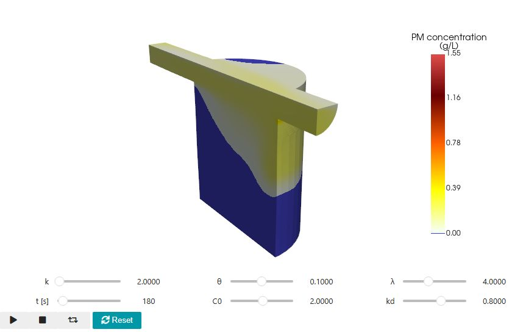
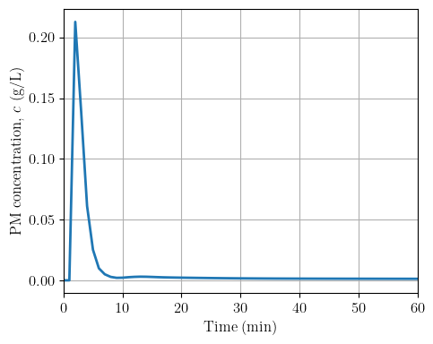

# 3‑D unsteady CPNN prediction of particulate matter transport  

This repository uses a composite neural network (CPNN) to predict the 3‑D particulate matter transport and fate in a hydrodynamic separator under transient loading conditions during a storm event.

## Interactive 3D preview



*Example prediction using the model in [CPNN_predictions.ipynb](CPNN_predictions.ipynb) at t = 180 s, with k = 2, θ = 0.1, λ = 4, C0 = 2, and kd = 0.8. The oblique view shows the separator's curved body and predicted particulate-matter concentration in g/L. Run the notebook locally to rotate the 3D view, adjust the storm-event parameters, and use the time, play, and reset controls.*

## Outlet-concentration prediction



*Saved output from [CPNN_predictions.ipynb](CPNN_predictions.ipynb). The notebook plots the mean predicted concentration at its selected outlet-region surface points over a 60-minute storm event.*

## Published research

Shatarah, M., Liu, K., and Li, H. (2026). [Operator-Based Machine Learning Framework for Generalizable Prediction of Unsteady Treatment Dynamics in Stormwater Infrastructure](https://doi.org/10.1061/JOEEDU.EEENG-8600). *Journal of Environmental Engineering*, 152(9), 04026047.

The study evaluated CPNN using 620 CFD storm-event simulations of a hydrodynamic separator: 496 for training, 62 for validation, and 62 for testing. The published evaluation reports the following agreement with CFD reference predictions:

| Predicted quantity | Test cases with R² > 0.8 relative to CFD |
|:---|:---|
| Hydrodynamics | 95.2% |
| Particulate-matter concentration | 72.6% |

For particulate-matter concentration, a further 22.6% of test cases had R² between 0.4 and 0.8. These scores describe agreement with simulated CFD fields for the studied separator and storm conditions. Performance varies across cases, with reported difficulties under extreme low-flow conditions.

## Quick start

### 1  Prerequisites
| Tool       | Tested version |
|:---        |:---            |
| **Git**    | 2.50+          |
| **Python** | 3.11 ×64       |

> *When installing Python on Windows, tick **“Add Python to PATH”**.*

### 2  Clone and set up
```bash
# 2-1 clone the repo
git clone https://github.com/Water-Infrastructure-Laboratory/cpnn.git
cd cpnn

# 2-2 create and activate a fresh virtual environment

# ▸ Windows (PowerShell)
py -3.11 -m venv .venv
.\.venv\Scripts\Activate.ps1

# ▸ Linux
python3.11 -m venv .venv
source .venv/bin/activate

# 2-3 upgrade pip, then install core dependencies
python -m pip install -U pip
pip install -r requirements.txt

# 2-4 Run the notebook
jupyter notebook
```
